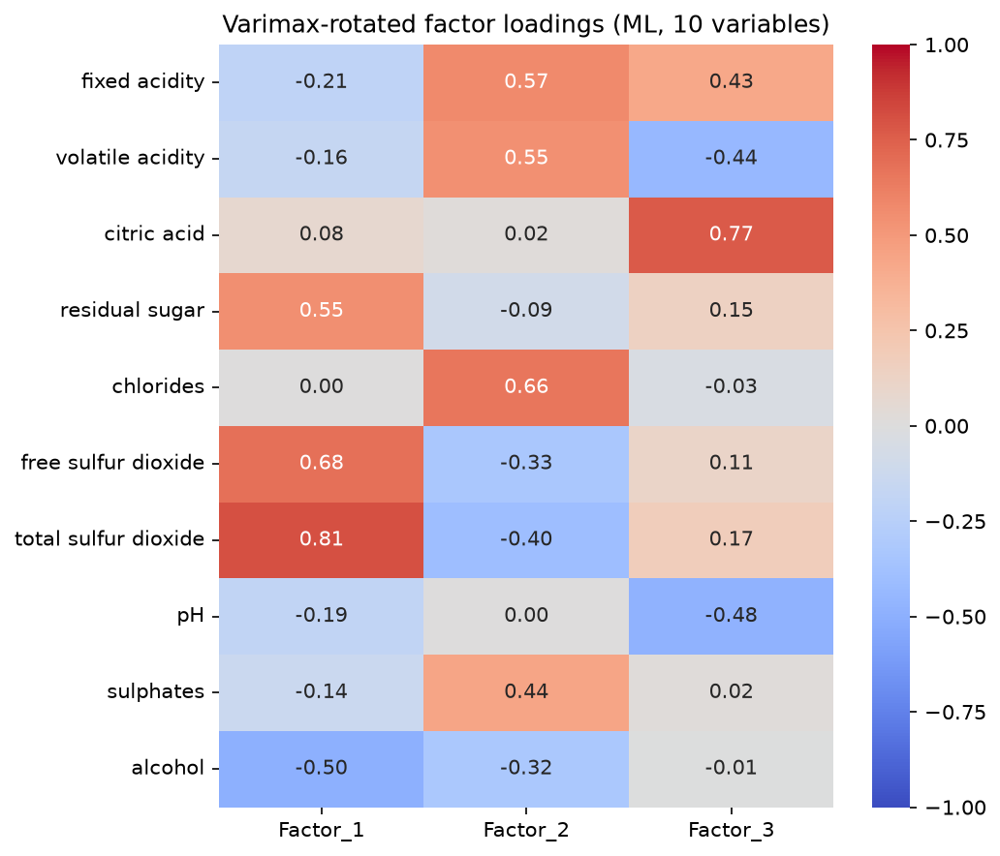
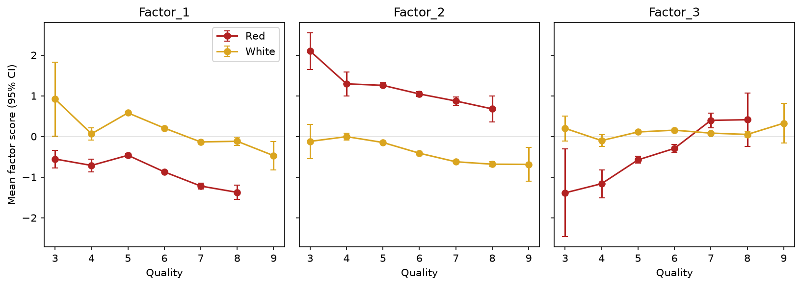

# Wine Quality Factor Analysis

[](https://github.com/lukahere007/wine-quality-analysis/actions/workflows/ci.yml)

[](LICENSE)

Do the 11 lab measurements on 6,497 Portuguese Vinho Verde wines (1,599 red, 4,898 white) reduce to a few interpretable latent dimensions, and do those dimensions track the quality score that tasters give? **Yes, three factors are supported, but they track quality only modestly.** The factors are sulfur/sugar vs alcohol, a "red-wine" salt and acid profile, and fixed acidity. Together they explain 47% of the variance. In cross-validation they explain 18-24% of the variance in quality, against 38% for a model on the raw variables. The strongest structure in the data is simply red vs white wine: k-means on the factor scores mostly rediscovers wine colour.

## Key results

All numbers come from executing [`notebooks/wine-quality-FA.ipynb`](notebooks/wine-quality-FA.ipynb).

**Suitability and number of factors.** The overall KMO is 0.41 with all 11 variables, which is below the usual 0.5 cut-off. The cause is density, which is almost a linear function of sugar and alcohol. Without density, KMO rises to 0.66. Horn's parallel analysis then retains **3 factors**: eigenvalues 3.03, 1.82 and 1.41, against about 1.04-1.08 for random data.



| Factor | Loads on | Correlation with quality (red / white) |
|---|---|---|
| 1. Sulfur and sugar vs alcohol | total SO2 +0.81, free SO2 +0.68, sugar +0.55, alcohol -0.50 | -0.39 / -0.26 |
| 2. Red-wine salt and acid | chlorides +0.66, fixed acidity +0.57, volatile acidity +0.55, sulphates +0.44 | -0.20 / -0.40 |
| 3. Fixed acidity | citric acid +0.77, pH -0.48, volatile acidity -0.44, fixed acidity +0.43 | +0.27 / +0.01 |



**Predicting quality.** These results use 5-fold cross-validation on the 5,320 unique wines; 1,177 exact duplicate rows were removed first. Scaling and factor analysis are refit inside every training fold.

| Model | CV R² | CV MAE |
|---|---|---|
| Baseline (predict the mean) | -0.004 | 0.695 |
| Linear regression on 3 factors + colour | 0.177 ± 0.017 | 0.620 |
| XGBoost on 3 factors + colour | 0.237 ± 0.033 | 0.603 |
| XGBoost on all 11 raw variables + colour | **0.380 ± 0.010** | **0.535** |

**Clustering.** The silhouette score picks k = 2 (0.38). The two clusters match wine colour for 97% of wines, so they are not quality profiles.

## Corrections to the earlier version

| Earlier version | Problem | Now |
|---|---|---|
| XGBoost on the factor scores "explains 59.2% of the variance" | Scored on the same rows it was trained on | The identical recipe, cross-validated on unique wines, gives R² = 0.111. The models above are all cross-validated. |
| Poisson GLM, "deviance ≈ Pearson χ² means good fit" | Quality is an ordinal score, not a count. The data are heavily under-dispersed (deviance 766 on 6,493 df). | Proportional-odds (ordinal logistic) regression |
| 3 factors, chosen without justification | No check on the number of factors | Parallel analysis, plus a KMO/Bartlett suitability check |
| `is_white` included as a factor-analysis variable | A binary label creates a "colour" factor | Colour is excluded from the factor analysis and used only for interpretation and as a covariate |
| Cluster interpretation ("Cluster 2 is associated with better quality") | Contradicted the printed table and ignored colour | Clusters are cross-tabulated against colour |
| Hard-coded `C:/Users/...` paths, invalid `requirements.txt`, committed `.ipynb_checkpoints` | The notebook would not run from a fresh clone | Relative paths, pinned requirements, CI that executes the notebook |

The red-wine CSV previously had a malformed, Excel-mangled header. It now uses the standard UCI format; the values are unchanged.

## Run it

```bash
git clone https://github.com/lukahere007/wine-quality-analysis.git
cd wine-quality-analysis
python -m venv .venv && source .venv/bin/activate    # Windows: .venv\Scripts\activate
pip install -r requirements.txt
jupyter lab notebooks/wine-quality-FA.ipynb
# or headless:
jupyter nbconvert --to notebook --execute --inplace notebooks/wine-quality-FA.ipynb
```

The notebook takes a few minutes to run, mostly because of the cross-validated factor-analysis pipelines. `factor_analyzer` 0.5.1 does not work with scikit-learn 1.8 or later, which is why scikit-learn is pinned to 1.7.2.

## Repository structure

```
wine-quality-analysis/
├── data/
│   ├── winequality-red.csv      # UCI, 1,599 wines, ';'-separated
│   └── winequality-white.csv    # UCI, 4,898 wines
├── figures/                     # written by the notebook
├── notebooks/
│   └── wine-quality-FA.ipynb    # the full analysis (committed with outputs)
├── requirements.txt
└── .github/workflows/ci.yml     # executes the notebook on every push
```

## Limitations

- The factors are estimated on red and white wines pooled together, although their chemistry differs. Separate factor models per colour are a natural next step.
- Even without density, KMO is only "mediocre" (0.66). The three factors capture under half of the variance.
- Quality is a median expert rating, concentrated at 5-7. Only 5 wines score 9 and 30 score 3, so trends at the extremes are noisy.
- The data come from one region (Vinho Verde, Portugal).

## Related project

[wine_shiny_app](https://github.com/lukahere007/wine_shiny_app) is an interactive R Shiny app on the red-wine subset of the same data. It fits an ordinal logistic regression on the raw chemistry and predicts quality probabilities.

## Data

Cortez, P., Cerdeira, A., Almeida, F., Matos, T., & Reis, J. (2009). Modeling wine preferences by data mining from physicochemical properties. *Decision Support Systems*, 47(4), 547-553. Data: [UCI Machine Learning Repository](https://archive.ics.uci.edu/dataset/186/wine+quality) (CC BY 4.0).

## Author

**Luke Wamalwa** · [GitHub](https://github.com/lukahere007) · [LinkedIn](https://linkedin.com/in/luke-wamalwa-839624292)

MIT License. See [LICENSE](LICENSE).
